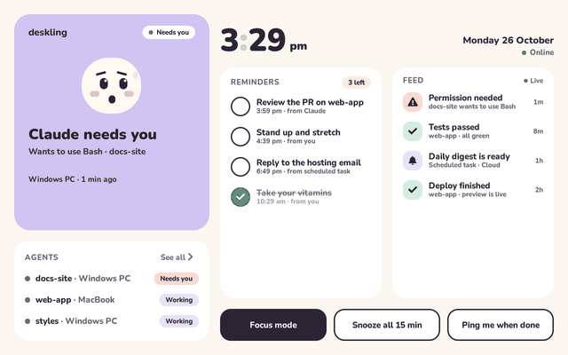
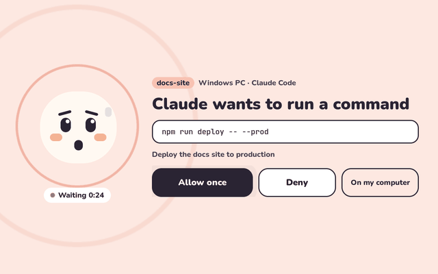
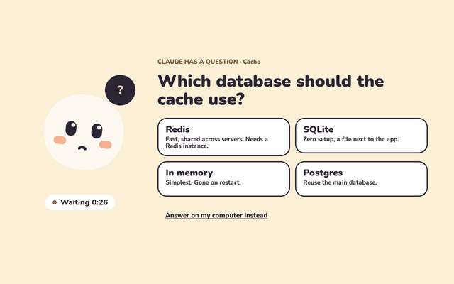
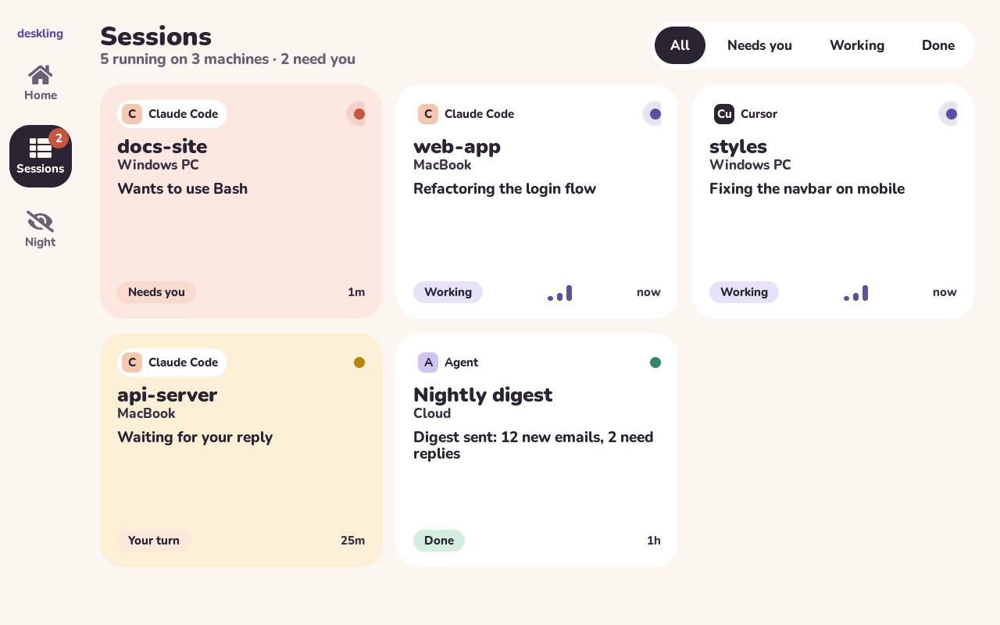
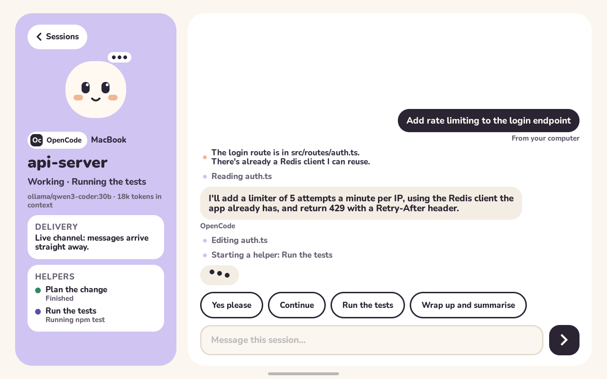
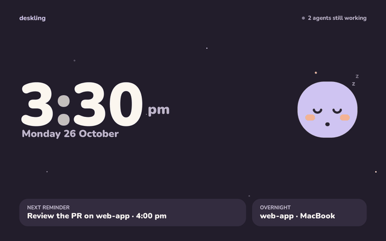
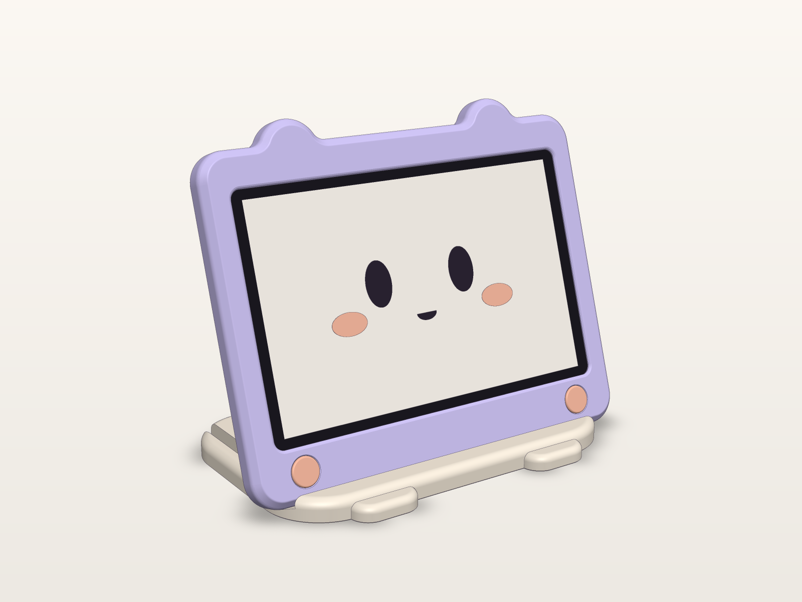

# Deskling

A cute, animated desk companion for your AI agents. **[deskling.mojolayers.com](https://deskling.mojolayers.com)**



Deskling is a 10.1" touchscreen that sits on your desk in landscape and keeps an eye on every agent you have running: Claude Code sessions on your Mac or Windows machine (terminal or desktop app), Cursor chats, scheduled tasks in the cloud, and anything else that can send an HTTP request. Its little character reacts to what's going on. It bobs while Claude works, panics when something needs your permission, tilts its head at a question, cheers when you tick off a reminder, and dozes off at night.

From across the room you can:
- **approve or deny** a permission request (Claude Code and Cursor)
- **answer Claude's questions** by tapping an option
- **message any Claude Code session** with quick replies or the on-screen keyboard
- **tick off reminders** that you or Claude set ("remind me at 3pm to…")
- see every session on every machine at a glance, with the ones that need you first
- **hear it**: little synthesized chirps for "needs you", questions, finished tasks and reminders, with quiet hours at night ([try them on the website](https://deskling.mojolayers.com))

| | |
| --- | --- |
|  |  |
|  |  |
|  |  |

## How it fits together

```
 Claude Code (Mac / Windows / desktop app)    Cursor        cron, CI, cloud tasks, other agents
   └─ plugin: hooks + MCP tools + channel      └─ hooks       └─ `deskling` CLI / HTTP
                    \                              |                 /
                     ▼                             ▼                ▼
            ┌───────────────────────────────────────────────────────────┐
            │  relay/  Cloudflare Worker + Durable Object                │
            │  sessions · feed · reminders (alarms) · pending approvals  │
            └───────────────────────────────────────────────────────────┘
                                  │  WebSocket (wss)
                                  ▼
            ┌───────────────────────────────────────────────────────────┐
            │  firmware/  ESP32-P4 + LVGL 9: animated UI, touch, Wi-Fi   │
            └───────────────────────────────────────────────────────────┘
```

## Repo layout

| Folder | What lives there |
| --- | --- |
| [`relay/`](relay/README.md) | Cloudflare Worker that agents talk to and the screen listens to, plus a browser simulator at `/sim` |
| [`hooks/`](hooks/README.md) | The Claude Code plugin (hooks, MCP tools, channel), Cursor hooks, and the `deskling` CLI |
| [`firmware/`](firmware/README.md) | ESP-IDF 6.1 project for the screen, plus a host simulator that renders every screen to PNG |
| [`case/`](case/README.md) | Parametric 3D-printable case: lilac Deskling bezel with ears and cheeks, back cover, 18° stand |
| [`site/`](site/) | deskling.mojolayers.com: landing page, browser installer, and the firmware update server (`/firmware/`). A Worker with static assets, auto-deployed by Cloudflare from this repo |
| `docs/` | Design and motion spec, hardware notes, screenshots |

## Setting it up

**[docs/setup.md](docs/setup.md)** walks through everything in about 20 minutes, with a test at each step:

1. **Deploy your relay.** It's your own free Cloudflare Worker, the meeting point for your agents and the screen. One click:

   [](https://deploy.workers.cloudflare.com/?url=https://github.com/moderniselife/deskling/tree/main/relay)

   Then open `https://<relay>/setup`. It has your copy-paste details and test buttons, and `/sim` is a working Deskling in the browser.
2. **Claude Code.** Run `/plugin marketplace add moderniselife/deskling`, then `/plugin install deskling@deskling`, and paste the relay URL and token. [Cursor and the CLI](hooks/README.md) are set up the same way.
3. **Screen.** Open [deskling.mojolayers.com/install](https://deskling.mojolayers.com/install) (or `https://<relay>/flash`) in Chrome or Edge and install over USB (once). Pick your Wi-Fi on the screen, then open `deskling.local` and paste the relay details. Updates arrive over the air after that.
4. **Case.** Print the fit template first, then the parts for your printer ([details](case/README.md)).

## Hardware

- **Board:** Guition JC8012P4A1C_I_W_Y. ESP32-P4 with 32 MB PSRAM, a 10.1" 800×1280 IPS capacitive panel (JD9365) over MIPI-DSI, GSL3680 touch, and an ESP32-C6 for Wi-Fi 6 / BLE 5 over ESP-Hosted.
- **Power:** a stable 5 V / 1 A+ supply.
- **More:** [`docs/hardware.md`](docs/hardware.md) has the pins, gotchas and measurements.

## Status

- [x] UI design and motion spec (home, sessions, chat, permission, question, night)
- [x] Relay with multi-session tracking, approvals, questions, messages, reminders, Cursor support (end-to-end tested)
- [x] Claude Code plugin: hooks, MCP tools (`deskling_remind`, `deskling_notify`, `deskling_reply`), channel for idle sessions
- [x] Cursor hooks and the `deskling` CLI
- [x] Firmware: builds for ESP32-P4; UI verified in the simulator
- [x] 3D-printable case (parametric, fit-checked in code)
- [ ] First boot on the real board: confirm LCD revision, touch orientation, C6 firmware
- [x] On-screen Wi-Fi setup, browser installer, settings page at `deskling.local`, over-the-air updates with rollback
- [x] Sounds: synthesized chirps through the ES8311 speaker, volume and quiet hours
- [x] Website with a live, playable Deskling and a public browser installer
