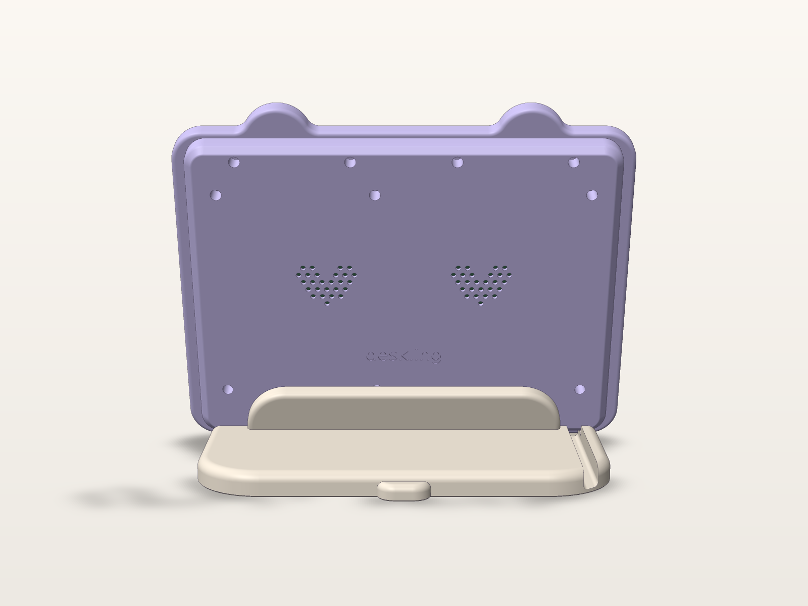
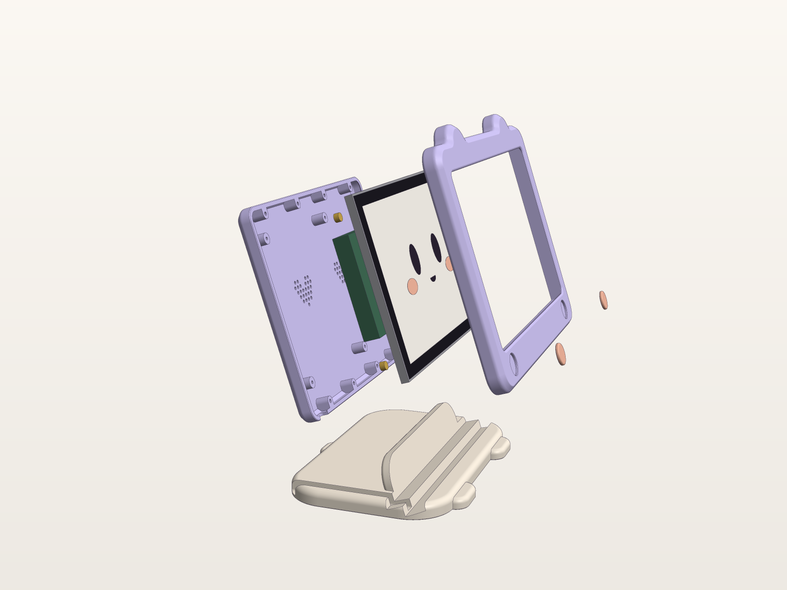
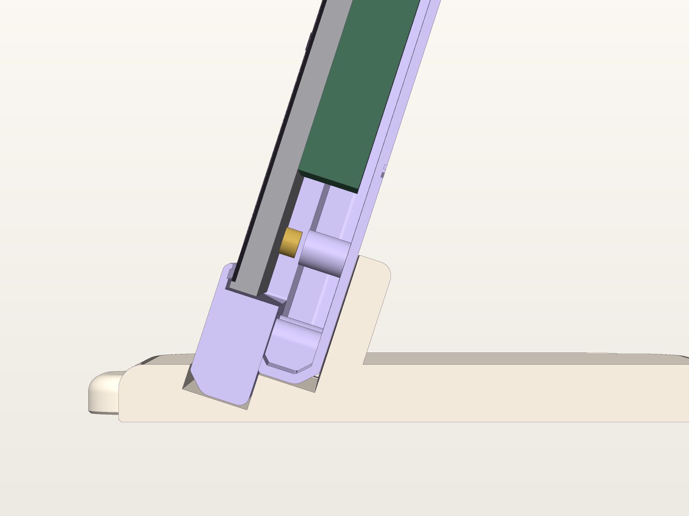
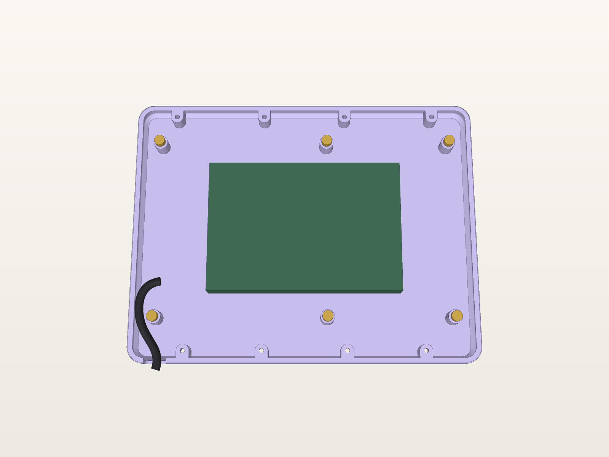

# Deskling case

A soft, chunky, 3D-printable housing that turns the 10.1" Guition panel into Deskling itself: the screen is its face, it has two round ears on top, peach blush cheeks on its chin, and it sits in a cradle with little toes and a tail.


| | |
|---|---|
|  |  |
|  |  |

Everything is generated by one parametric script:

```sh
pip install --break-system-packages build123d numpy matplotlib scipy
python3 case/deskling_case.py              # build + fit checks + STL/STEP + renders (~7 min)
python3 case/deskling_case.py --no-render  # build + checks + export only (~30 s)
```

All dimensions are named parameters at the top of `deskling_case.py` (mm). The script runs about 30 fit checks with `assert` before it exports anything. If a measurement changes and something no longer fits, the build stops and names the failing check. The checks cover: panel in the pocket, active area inside the window, the module plus a 30 mm USB-C plug at all nine ±6 mm offset positions, a 6 mm cable route to the exit slot, screw lengths, split halves, the case seated in the stand groove, centre of mass and tip-over force, and the print-bed size of every part.

## Parts

| File (`stl/` and `step/`) | Qty | Size (X × Y × Z on the bed) | Fits | Colour suggestion |
|---|---|---|---|---|
| `bezel_onepiece.stl` | 1 | 265.0 × 216.5 × 15.8 | **Snapmaker U1 only** (270 bed) | lilac `#CFC4F2`-ish |
| `bezel_left.stl` + `bezel_right.stl` | 1 each | 138.5 / 132.5 × 216.5 × 15.8 | any (A1, P1S, U1) | lilac |
| `back_cover.stl` | 1 | 248.0 × 190.3 × 14.4 | any | lilac (or a darker lilac/ink for contrast) |
| `stand.stl` | 1 | 236.0 × 169.0 × 40.7 | any | cream `#FBF6EF`-ish |
| `cheek_insert.stl` | **2** | 17.9 Ø × 2.6 | any | peach `#F4C7AE` |
| `fit_test_template.stl` | 1 | 248.8 × 163.2 × 6.0 | any | anything (draft quality) |
| `step/deskling_assembly.step` | | assembled on the stand (reference only) | | |

Print either the one-piece bezel **or** the two halves, not both.

**Snapmaker U1, multi-colour option:** print the one-piece bezel in lilac and paint the two cheek recess floors peach in the slicer, so the cheeks print in place. The recess floor is the first 2 mm off the bed (the bezel prints face-down), so the colour change happens in the first ~10 layers. Then you don't need the cheek inserts.

## Print settings

| | Bezel (either version) | Back cover | Stand | Cheeks | Fit template |
|---|---|---|---|---|---|
| Material | PLA or PETG (PETG if it sits in a sunny window) | PLA / PETG | PLA (heavier = better) | PLA | PLA |
| Orientation | **face-down** (front face on the bed), as exported | **back face down**, as exported | as exported (bottom down) | flat, as exported | flat, as exported |
| Layer height | 0.16–0.20 mm | 0.20 mm | 0.20–0.24 mm | 0.12–0.16 mm | 0.28 mm |
| Walls | 4 (1.6 mm) | 3 | 4 | 2 | 2 |
| Top/bottom | 5 / 5 | 5 / 5 | 5 / 4 | full | 3 / 3 |
| Infill | 15 % gyroid | 15 % gyroid | 25–40 % gyroid (it's ballast) | 100 % | 15 % |
| Supports | **none** | **none** | **none** | none | none |
| Brim | 5 mm brim on the split halves (thin arms); optional on the one-piece | no | no | no | no |

Notes for the slicer:

- Every bed-facing outer edge is a 45° chamfer blended with fillets, so the soft front of the bezel and the soft back of the cover print without supports. On the bed they look chamfered. Upright they read as round.
- Bezel: the window's front edge has a 1.2 mm 45° chamfer and the cheek recesses are on the bed face. The insert holes, pocket and dovetail grooves all open upward. The dovetail tongues have a 45° underside, so they aren't flat cantilevers.
- Back cover: the counterbores open onto the bed and the screw holes bridge over them (6.4 mm bridges). The heart grilles and "deskling" wordmark are on the bed face, so they come out crisp. The wordmark is mirrored in the model so it reads correctly from behind.
- Stand: the coin pockets (26.5 mm) and rubber-foot recesses are on the underside and bridge cleanly. The groove walls lean 18°, well inside any printer's overhang limit.
- Turn on "elephant foot compensation" (~0.15 mm) if your profile doesn't already. The parts also have 0.4–0.6 mm bottom chamfers.

## Hardware (BOM)

| Item | Qty | Use |
|---|---|---|
| **M2.5 × 6 mm** socket-head or button-head screws | 6 | back cover → brass standoffs on the panel. **Confirm the thread first** (see below). If the standoffs are M3, use M3 × 6 and set `PANEL_SCREW = "M3"`. |
| **M3 heat-set inserts**, M3 × 5.7 long × 4.6 OD ("standard" CNC Kitchen / Ruthex size) | 8 | pressed into the bezel's rear face, 4 above and 4 below the panel |
| **M3 × 8 mm** socket-head or button-head screws | 8 | back cover → bezel inserts |
| Foam tape, 2–3 mm wide, ~0.5 mm thick (optional) | ~0.8 m | sits in the 0.4 mm channel on the back of the bezel lip, around the window, to cushion the glass and take up the 0.3–0.8 mm gap |
| Rubber bumpons, 12.7 mm Ø (optional) | 4 | recesses under the stand |
| Coins or steel slugs, ≤ 26.5 mm Ø (optional) | up to 4 stacks × 7 mm | ballast pockets under the stand (UK 2p, €2, US quarter all fit). Glue them in or cover them with felt. |
| USB-C cable, ≤ 6 mm thick (straight or right-angle plug) | 1 | power |

Counterbores are 6.4 mm Ø, which fits M2.5 and M3 socket or button heads. Screws are 3 mm below the back surface, so they're hidden.

## How it holds together (and why heat-set inserts, not clips)

```
 front ->  [bezel lip]  foam  [glass/panel]  standoffs ->  [back cover] <- screws from behind
              |                                              |
              +---- 8x M3 heat-set inserts <-- M3x8 ---------+
```

1. The **back cover screws to the six panel standoffs** (M2.5). This locks the panel to the back cover and sets its depth exactly. The cover's columns land on the standoff tips.
2. The **bezel slides over the panel from the front**. **Eight M3 screws** go from the back cover into heat-set inserts in the bezel's rear face. The panel is sandwiched between the bezel lip (with optional foam) and the back cover.
3. On the **split bezel**, two blind dovetails per seam align the halves (one on the forehead, one on the chin). They aren't visible from the front: the tongue stops 3 mm short of the front face, so the front shows only a 0.4 mm V hairline. The back cover then **bridges the seam**: the screws at x = ±30 mm sit 30 mm either side of it, top and bottom, so the screwed-down cover clamps both halves into one rigid frame. A drop of CA glue in the dovetails makes it permanent but isn't needed.

I chose heat-set inserts over printed snap clips because the bezel has to clamp a 600 g glass panel. Clips in PLA creep and loosen, they're hard to make undetectable on a soft rounded shell, and they would make the split joint depend on the clips. Inserts let you open the case again and again for firmware or USB work.

## Assembly

1. **Test-fit first** (see "Before printing" below).
2. Press the 8 heat-set inserts into the bezel's rear face (iron at ~220 °C for PLA). Set them flush or 0.2 mm below the surface.
3. Split bezel: slide the right half's dovetail grooves onto the left half's tongues from the back. They only go together one way. Lay the joined bezel face-down on a towel.
4. Optional: lay foam tape in the shallow channel on the lip, around the window.
5. Drop the panel in face-down. The **USB-C ports must point to the right while you look at it from the back** (the ports end up on the user's left from the front).
6. Plug the USB-C cable into the module. Route it **outboard of the lower-left standoff** (left as seen from the front) and down to the slot in the bottom edge of the back cover.
7. Lay the back cover on with the cable in the slot. Fit the 6 × M2.5 screws into the standoffs first, snug but not tight, then the 8 × M3 screws into the bezel, then tighten everything gently.
8. Optional: press-fit the two peach cheeks. They're 0.1 mm undersize and stand 0.6 mm proud like little pillows. Add a dot of glue if they're loose.
9. Stick the rubber feet (and coins, if used) under the stand. Drop Deskling into the groove with the cable in the stand's cable channel on the left. The channel runs out the back.

## Before printing: check on the real device

These are the assumptions that matter most. Each is one parameter at the top of the script.

| Check | Parameter(s) | Why |
|---|---|---|
| **Standoff thread**: does an M2.5 screw thread in, or M3? | `PANEL_SCREW` | the vendor drawing shows Ø2.5 holes, which usually means M2.5 brass standoffs |
| **Standoff height** above the panel's back plane (calipers, depth rod) | `SO_H` (4.5) | sets where the back cover sits. ±0.5 mm matters for the screw length and how hard the panel is clamped |
| **Standoff pattern**: 128.7 mm between rows, 90.0 / 122.8 mm spacing along a row, and which side the 90 mm gap is on | `SO_X_BACKVIEW`, `SO_ROW_PITCH` | from the vendor drawing, viewed from the back. **From the front the off-centre middle standoff sits 16.4 mm to the right of centre.** If it's actually on the left, the module and port orientation in the drawing is mirrored too |
| **Module position**: how far off-centre (X and Y), and its true depth | `MOD_OFFSET` (6), `MOD_D` (15.5) | the cavity allows ±6 mm and 15.5 mm deep plus 2.5 mm clearance |
| **USB-C ports**: face the user's left from the front? How far from the module's bottom edge? Plug length with the user's cable | `PLUG_LEN` (30), `CABLE_SLOT_X` | there is a ~30 mm cable bay on that side, and the exit slot is at the bottom left (front view) |
| **Panel thickness** at the frame edge (7.0 drawing / 7.5 measured) | `POCKET_D` (7.8) | the pocket fits 7.5. If the real panel is 7.0, use 0.8 mm foam |
| Active area centred? | `ACTIVE_TOL` (2) | the window leaves 5.4 mm (X) / 3.9 mm (Y) of margin around the active area, including ±2 mm uncertainty |
| Any other connectors, buttons, a speaker on the module's back, or the SD card slot? | | the back cover has two heart grilles in front of the module's back face (one behind the speaker) and 2.5 mm of air. Anything that pokes further out needs a cut-out |

### Cheap test print: `fit_test_template.stl`

A 2 mm plate (about 40 g, roughly 1 h 15 min at 0.28 mm) that checks every critical dimension before you commit to the 6–8 hour bezel and cover prints:

1. Lay the panel face-down on a towel and drop the template onto its back, with the **notch on the ports side**.
2. **Standoffs:** all six brass bosses must pass through the six holes (Ø7.9). If one is off, the pattern or mirroring is wrong.
3. **Module:** it must pass through the big centre window. The window is the module plus the full ±6 mm offset allowance, so you can see how much margin is left on each side.
4. **Panel size:** the four corner fences on the underside are exactly the bezel pocket (245.6 × 160.0). The panel's frame must drop between them with a little play on all sides.
5. While it's on, measure how far the standoff tips stick up above the template (plus 2.0 mm = `SO_H`) and the module depth.

## Main dimensions

| | |
|---|---|
| Overall (bezel, front view) | 265 W × 216.5 H including ears (202.5 without), 16 mm forehead, 26 mm chin |
| Overall depth of the unit (bezel front to back cover) | 30.2 mm |
| Window | 231.3 × 147.2, r6, overlaps the glass by 4 mm all round |
| Panel pocket | 245.6 × 160.0 × 7.8 deep |
| Back cover | 248 × 190.3, 2.4 mm walls, 2.5 mm air behind the module |
| On the stand | tilted back 18°, 236 × 150 base (plus toes and tail), ~250 g of PLA, ~1.0 kg total with the device |
| Stability | centre of mass 75 mm behind the front edge and 86 mm ahead of the rear edge. It takes about 5.8 N (~600 g) pressing on the top of the screen to tip it back with no ballast, before adding coins |

## Coordinate conventions in the script

The device frame has its origin at the centre of the panel's back plane. +X is to the user's right (looking at the screen), +Y is up, +Z is toward the user. The vendor drawing's hole positions are "viewed from the back", and `standoff_positions()` mirrors X once. That is the only place it happens.
